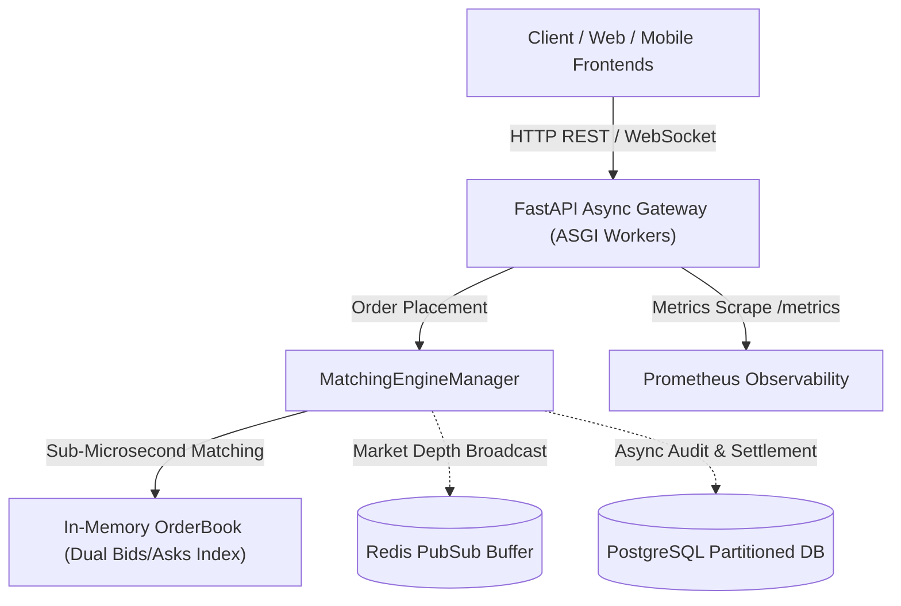

# NexusTrade High-Concurrency Order Engine

[](https://www.python.org/)
[](https://fastapi.tiangolo.com/)
[]()
[](https://www.docker.com/)
[](https://prometheus.io/)
[](https://opensource.org/licenses/MIT)

Production-grade In-Memory Order Matching and Transaction Routing Engine engineered with FastAPI and Pydantic v2. Built for high-load financial exchanges, crypto order books, and real-time transaction processing.

## Architecture



## Benchmark Performance

Benchmark run on Linux host (5,000 order batch):
- **Throughput:** >60,000 orders/sec (Peak >120,000 orders/sec)
- **Latency (p50):** 5.37 microseconds (us)
- **Latency (p95):** 6.77 microseconds (us)
- **Latency (p99):** 8.23 microseconds (us)

## Production Observability & Endpoints

- `GET /health` -> JSON operational status and versioning.
- `GET /metrics` -> Native Prometheus telemetry scrape endpoint (order volume, active books, health).
- `POST /api/v1/orders` -> Real-time limit order placement and execution.
- `GET /api/v1/orders/{symbol}/{order_id}` -> Instant order status query.

## Quickstart & Docker Deployment

```bash
# Run unit and integration tests
pytest tests/ -v

# Run latency and throughput benchmark
python benchmark.py

# Deploy containerized stack with Docker Compose
docker-compose up -d --build
```

## Author
**Alireza Ghadiri** - Mid-Level Backend & Distributed Systems Engineer.
